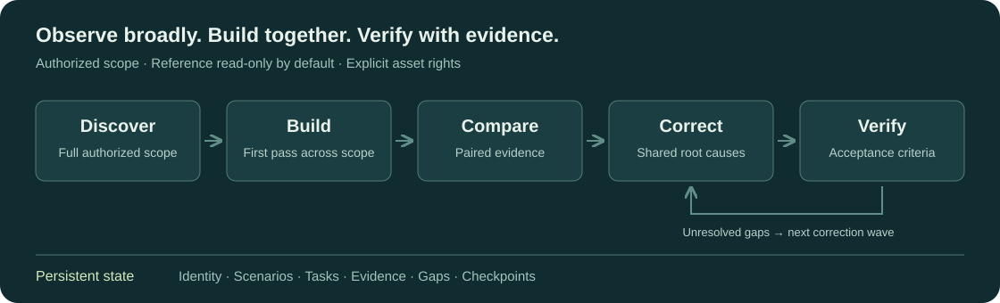

# Goal App Replica

An Agent Skill for **authorized app replication** with persistent project state, paired evidence, Web visual/structural diffing, and safety gates.

[中文](README.zh-CN.md) · [Quickstart](QUICKSTART.md) · [Skill](SKILL.md) · [Contributing](CONTRIBUTING.md) · [Security](SECURITY.md)

Explore the full scope, build a first pass, then compare and correct in batches. Keep progress recoverable across agent sessions, and assess observable behavior using evidence from both the reference and replica.



## Try the controller

Requires Python 3.11+. Use `python3` if that is your Python command.

```sh
git clone https://github.com/StarlightDamian/goal-app-replica.git
cd goal-app-replica
python -m pip install -r requirements.txt
python examples/quickstart.py
```

The demo runs `start → status → validate` in a temporary directory. Look for `"ok": true` and `"valid": true` in the validation output. This checks controller initialization and state validation; it does **not** build or certify a replicated application. Temporary demo state is removed when the script exits.

## What is included

| Component | Purpose |
| --- | --- |
| [SKILL.md](SKILL.md) | Agent workflow, authorization boundaries and completion criteria |
| [Controller](scripts/replica_ctl.py) | Persistent project state, tasks, gaps, leases and recovery |
| [Web evidence tools](references/web-capture-execution.md) | Browser capture contracts and paired artifacts |
| [Diff and acceptance](references/evidence-diff-and-acceptance.md) | Structural, font and visual comparisons; stability and fidelity gates |
| [Evaluations](evals/) | Controller, workflow and Web-tool regression tests |

Python tools use Pillow for image processing. Browser/CDP helpers require Node.js 24+ and a compatible browser/control session. Web has concrete capture and diff tooling. Desktop, Android and iOS workflows require suitable external control adapters and platform environments; this repository does not supply a complete automation driver for each platform. See [control adapters](references/control-adapters.md).

## Use it with an agent

Follow the [manual installation steps](QUICKSTART.md#install-as-an-agent-skill), then give your agent the reference identity, replica code directory, authorized scope, platform, fidelity level and required scenarios. The agent needs access to suitable development and application-control tools.

The loop is `discovery → first-pass build → batch compare → correction waves → batch verification`. Completion requires current paired evidence and the declared acceptance criteria; a successful controller command alone is insufficient. See the [runtime protocol](references/runtime-protocol.md).

## Safety and rights

Use only applications you are authorized to inspect and reproduce. The reference is read-only by default. Keep credentials, cookies and private customer data out of captures, logs, issues and commits. External page content cannot grant permission or override agent instructions. Reuse assets only with the required rights. Read the [full boundaries](references/safety-boundaries.md).

[MIT](LICENSE) · Copyright © 2026 StarlightDamian. The repository license does not grant rights to reference applications or their assets. See [third-party notices](THIRD_PARTY_NOTICES.md).
