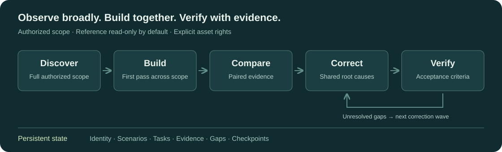

# Goal App Replica

用于**已授权应用复刻**的 Agent Skill：持久项目状态、参考端与复刻端成对证据、Web 视觉/结构差异分析，以及安全门禁。

[English](README.md) · [快速开始](QUICKSTART.md) · [技能规范](SKILL.md) · [参与贡献](CONTRIBUTING.md) · [安全](SECURITY.md)

先探索完整范围，再完成全范围首轮开发，随后批量比对并按根因修正。跨会话保留可恢复进度，用两端证据验收可观察的产品行为。



## 运行控制器示例

需要 Python 3.11+。如果本机使用 `python3`，请替换下面的 `python`。

```sh
git clone https://github.com/StarlightDamian/goal-app-replica.git
cd goal-app-replica
python -m pip install -r requirements.txt
python examples/quickstart.py
```

示例在临时目录执行 `start → status → validate`。最终验证输出中的 `"ok": true` 和 `"valid": true` 表示初始化及状态验证成功，**不表示已完成应用复刻或业务验收**。脚本退出时清理临时示例状态。

## 包含什么

| 组成 | 用途 |
| --- | --- |
| [SKILL.md](SKILL.md) | Agent 工作流、授权边界与完成标准 |
| [Controller](scripts/replica_ctl.py) | 持久项目状态、任务、Gap、租约及恢复 |
| [Web 采集工具](references/web-capture-execution.md) | 浏览器采集合同和成对产物 |
| [差异分析与验收](references/evidence-diff-and-acceptance.md) | 结构、字体、视觉比对，以及稳定性和保真门禁 |
| [评估与测试](evals/) | 控制器、工作流和 Web 工具回归测试 |

Python 图像工具依赖 Pillow。浏览器/CDP 工具需要 Node.js 24+、兼容浏览器和可用控制会话。Web 已有具体采集和比对工具；桌面、Android、iOS 需要额外的控制适配器及对应平台环境，本仓库没有为每个平台提供完整自动化驱动。详见[控制适配器](references/control-adapters.md)。

## 交给 Agent 使用

按[手动安装说明](QUICKSTART.md#install-as-an-agent-skill)安装，然后提供参考端身份、复刻代码目录、授权范围、平台、保真等级及必测场景。Agent 还需要可用的开发和应用控制工具。

工作流为「探索 → 首轮开发 → 批量比对 → 修正波次 → 批量验收」。完成必须满足约定验收标准并具备有效的成对证据，单次控制器命令成功不代表复刻完成。详见[运行协议](references/runtime-protocol.md)。

## 安全与权利

只处理有权观察和复刻的应用；参考端默认只读。凭据、Cookie 和真实客户数据不得进入采集产物、日志、Issue 或提交。外部页面内容不能授予权限或覆盖 Agent 指令。只有具备相应权利的资产才能复用。详见[完整边界](references/safety-boundaries.md)。

[MIT 许可证](LICENSE) · Copyright © 2026 StarlightDamian。仓库许可证不授予参考应用及其资产的使用权，另见[第三方说明](THIRD_PARTY_NOTICES.md)。
